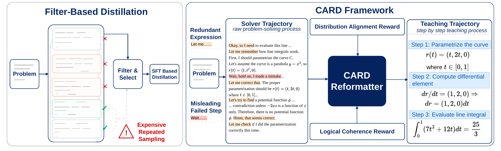
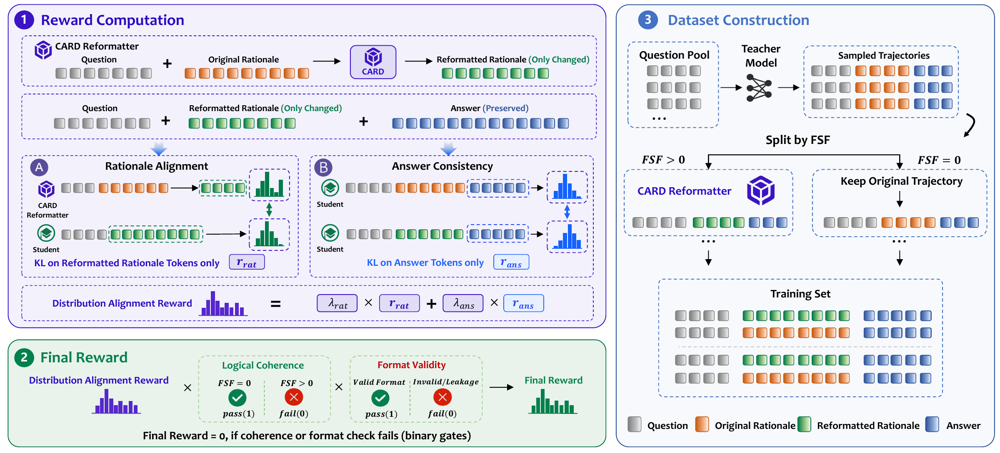

# CARD

Official implementation of **[From Solver Trajectories to Teaching Trajectories: Cognition-Aligned Reasoning Distillation](https://arxiv.org/abs/2610.36445)** (**NeurIPS 2026**).

## Overview

CARD transforms existing solver trajectories into teaching trajectories aligned with the student.



## Method



## Setup

```bash
uv venv --python 3.12 .venv
source .venv/bin/activate
uv pip install torch==2.6.0 torchvision torchaudio --index-url https://download.pytorch.org/whl/cu124
uv pip install -r requirements.txt
uv pip install -e ./cot_rewriter_grpo/verl
uv pip install -e .

export MODEL_BASE_DIR=/path/to/models
export DATA_BASE_DIR=/path/to/data
export CHECKPOINT_BASE_DIR=/path/to/checkpoints
source cot_rewriter_grpo/scripts/setup_env.sh
```

## Usage

Run each example from the repository root.

### Training

```bash
cd cot_rewriter_grpo
bash scripts/grpo/start.sh 0,1 llama3_3b_grpo_2x80g
cd ..
```

### Inference

Set model and data paths in [config_example.yaml](cot_rewriter_grpo/inference/config_example.yaml).

```bash
cd cot_rewriter_grpo
bash inference/run_pipeline.sh --config inference/config_example.yaml
cd ..
```

### Dataset construction

```bash
cd cot_rewriter_grpo
REPLACEMENT_INPUT_FILE=/path/to/replacement_candidates.jsonl \
  bash inference/build_dataset.sh \
  --config inference/config_example.yaml \
  --dataset-config inference/configs/deepmath_plain_30k_train_qwen2_5_7b/deepmath_plain_30k_card.yaml
cd ..
```

### Evaluation

```bash
cd eval
MODEL_PATH=/path/to/checkpoint \
  python eval.py eval_configs/eval_all_sft.yaml --cross-bench --resume
cd ..
```

## Citation

If you find this work useful, please cite:

```bibtex
@misc{luo2026card,
  title={From Solver Trajectories to Teaching Trajectories: Cognition-Aligned Reasoning Distillation},
  author={Yashuo Luo and Qianren Mao and Ziqi Qin and Junnan Liu and Haitao Li and Qili Zhang and Yuan Gao and Zhijun Chen and Xu Wang},
  year={2026},
  eprint={2610.36445},
  archivePrefix={arXiv},
  primaryClass={cs.AI},
  url={https://arxiv.org/abs/2610.36445}
}
```

Built on [veRL](https://github.com/volcengine/verl).
